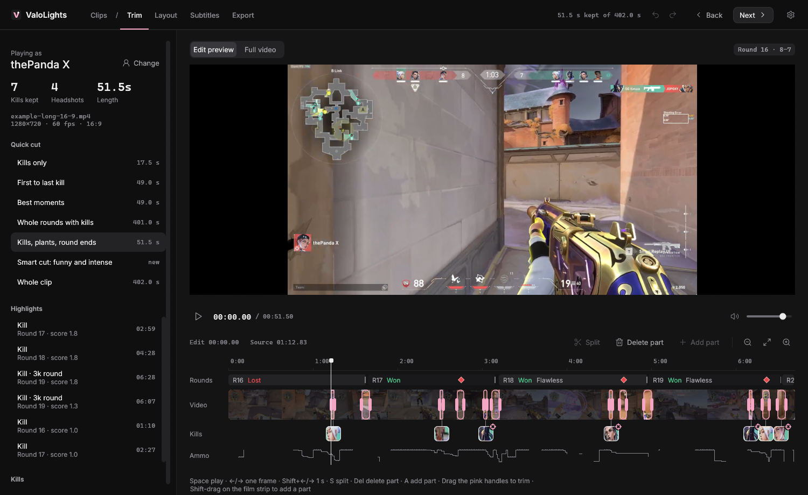
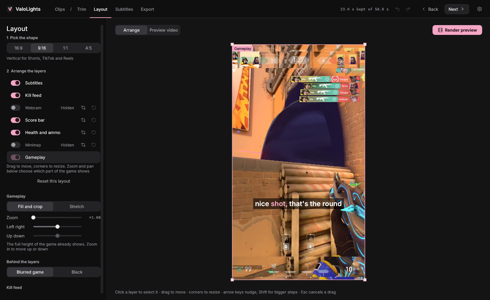
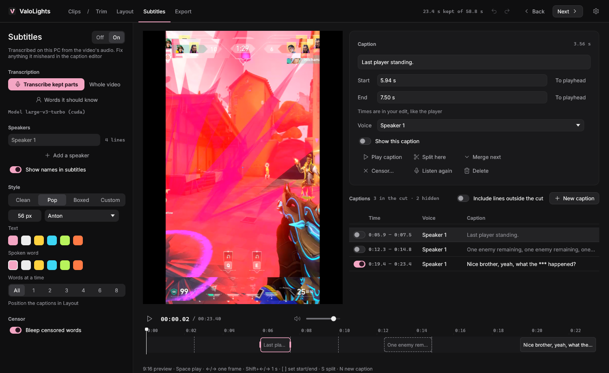
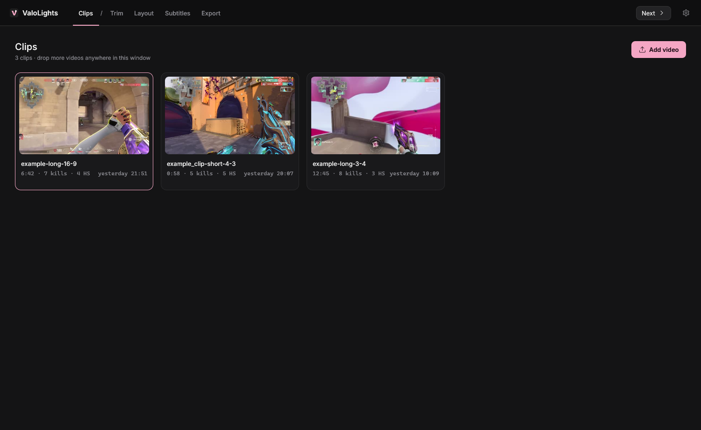
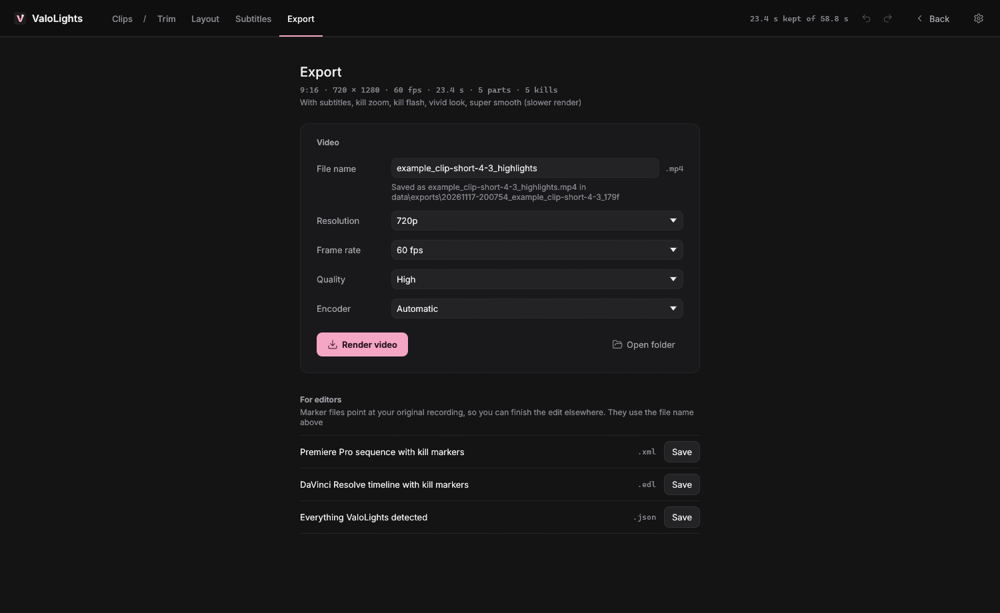

<div align="center">


# ValoLights

**Turn your Valorant recordings into highlight clips, on your own PC.**

ValoLights watches your match, finds your kills, clutches and funniest moments, and gives you an editor to
cut them into a video for YouTube, TikTok or Discord, with subtitles, music and smooth motion.

[](https://github.com/thePanda-X/ValoLights/actions/workflows/ci.yml)
[](https://github.com/thePanda-X/ValoLights/releases/latest)
[](LICENSE)


[**Download**](https://github.com/thePanda-X/ValoLights/releases/latest) ·
[Features](#features) · [Getting started](#getting-started) · [Building from source](#building-from-source)



</div>

## Features

**Finds the moments for you**
- Reads the kill feed to find *your* kills by name, so kills by teammates you were spectating after you died
  aren't counted as yours. Works with "hide names" (you show up as "Me") and with several accounts.
- Knows the rounds, spike plants and round results, and spots clutches, aces, flawless rounds and multi-kills.
- **Smart cut** also listens to the clip: laughter, shouting and hype in voice chat ("no way!", "let's go")
  lift a highlight or become a moment of their own. Every highlight says why it was picked.
- Quick cuts for every taste: kills only, best moments, whole rounds, kills with plants and round ends, or the
  whole clip.

**An editor made for it**
- Trim timeline with a film strip, your kills and rounds, per-kill on/off, split, add and delete, and undo for
  everything.
- Layouts for **16:9, 9:16, 1:1 and 4:5**: place the gameplay, score bar, minimap, health and ammo, your
  webcam, the kill feed and subtitles wherever you want, and adjust what each one crops.
- **Subtitles** for your voice chat, transcribed on your PC (Whisper, GPU-accelerated), with a caption editor,
  styles, "words at a time" and censored words that are bleeped.
- **Music** under the whole video, placed by hand, or synced so the drop lands on your first kill and the cuts
  land on the beat.
- **Super smooth** motion blur that makes 60 fps footage feel cinematic, by fast optical flow or AI frame
  interpolation.
- Colour looks, punch-in zoom and flashes on kills, transitions between cuts.

**Export**
- MP4 at 720p up to 4K (2160p), 30 or 60 fps, encoded on your NVIDIA GPU when there is one.
- Or hand the edit to a pro editor: Premiere Pro sequence (XML) or DaVinci Resolve timeline (EDL) with kill
  markers, plus a JSON file with everything ValoLights detected.

**Private by design.** Your recordings are analysed on your own computer and never uploaded. The only network
access is downloading models on first use and checking GitHub for updates (which you can turn off).

## Screenshots

| | |
|---|---|
|  |  |
| **Layout**: vertical 9:16 with live HUD crops, kill feed and captions | **Subtitles**: voice chat transcribed on your PC, censoring with bleeps |
|  |  |
| **Clips**: drop in recordings; analysis runs in the background | **Export**: MP4, or markers for Premiere Pro and DaVinci Resolve |

## Getting started

### Requirements

- Windows 10 or 11, 64-bit
- An NVIDIA graphics card is recommended (fast video decoding and encoding, GPU speech-to-text, AI frame
  interpolation). Everything also works without one, just slower.
- An English Valorant client (the kill feed and round banners are read as text).

### Install

1. Download **`ValoLights-Setup-<version>.exe`** from the [latest release](https://github.com/thePanda-X/ValoLights/releases/latest).
2. Run it. It installs for your user only (no administrator rights needed) and downloads ffmpeg, mpv and NVIDIA
   cuBLAS (about 550 MB) from their official sources during setup.
3. Windows may warn that the installer is from an unknown publisher, because it isn't code-signed yet: click
   **More info → Run anyway**.

ValoLights checks for updates when it starts and can update itself; Settings → Updates has a **Check now**
button and an off switch.

### Make your first clip

1. Enter your Riot name(s) when asked.
2. Drop a recording (or a replay you recorded) into the window. Analysis takes a few minutes for a full match.
3. **Trim**: pick a quick cut (try **Smart cut**) and fine-tune it on the timeline.
4. **Layout**: choose 16:9 or vertical 9:16 and arrange the layers.
5. **Subtitles** *(optional)*: transcribe the voice chat and fix any misheard words.
6. **Export**: render the video, or save it for Premiere Pro or DaVinci Resolve.

Everything you make is kept in the `data` folder next to the app (Settings → Data folder → Open).

## How it works

| Step | What happens |
|---|---|
| Analysis | ffmpeg decodes the recording (on the GPU) at 6 frames per second; the kill feed, score bar, timer and HUD are found by their layout and read with OCR (PP-OCRv6 on ONNX Runtime). Tracked kill feed rows become kills, players are clustered into teams and "you", and rounds come from the score and timer. |
| Smart cut | YAMNet listens for laughter, shouting and cheering; loud voice moments and words in the transcript count too. |
| Subtitles | A separate helper runs Whisper (whisper.cpp) on your GPU, or on the CPU, and splits the speech into timed captions. |
| Editing | The editor is written in Rust with egui; video playback uses libmpv. |
| Export | One ffmpeg filter graph composes the layout, overlays, subtitles, music and effects. Super smooth uses an optical-flow motion blur written in Rust, or RIFE on the GPU. |

More detail in [docs/development.md](docs/development.md) and the crate notes in `crates/*/NOTES.md`.

## Building from source

You need Rust (MSVC), CMake and, for GPU speech-to-text, the CUDA toolkit 13.2.

```powershell
git clone https://github.com/thePanda-X/ValoLights.git
cd ValoLights
powershell -ExecutionPolicy Bypass -File tools\fetch_binaries.ps1   # ffmpeg, mpv, RIFE, models (pinned, checked)
cargo run --release -p vl-app
```

See [docs/development.md](docs/development.md) for the full setup, tests, the scripted UI checks and packaging,
and [docs/releasing.md](docs/releasing.md) for how releases and updates are built.

## Roadmap

- Linux and macOS builds: the app is portable Rust; the installer, updater install step and bundled binaries
  are the Windows-specific parts.
- More game client languages.
- Code-signed installer.

Ideas and bug reports are welcome in the [issues](https://github.com/thePanda-X/ValoLights/issues).

## Contributing

Contributions are welcome. Please read [CONTRIBUTING.md](CONTRIBUTING.md). Security issues go through
[SECURITY.md](SECURITY.md).

## License

ValoLights is released under the [MIT License](LICENSE). Bundled and downloaded third-party components keep
their own licences; see [docs/third-party.md](docs/third-party.md).

ValoLights isn't endorsed by Riot Games and doesn't reflect the views or opinions of Riot Games or anyone
officially involved in producing or managing Riot Games properties. Riot Games and all associated properties are
trademarks or registered trademarks of Riot Games, Inc.
